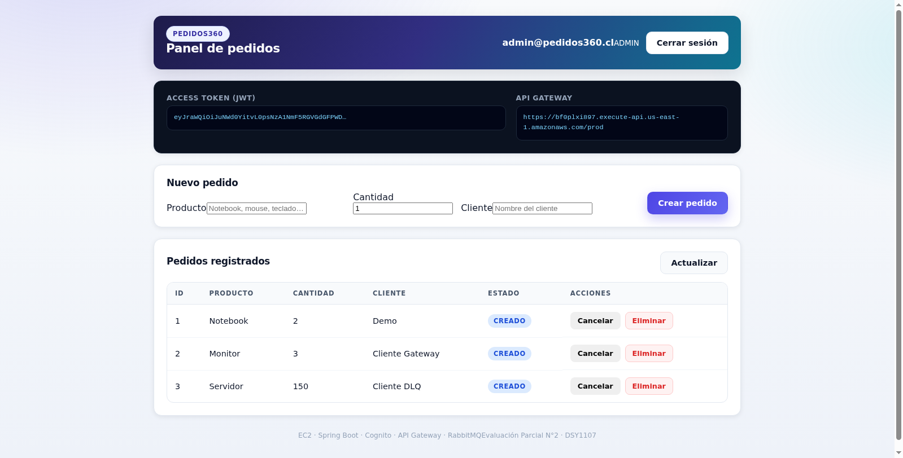
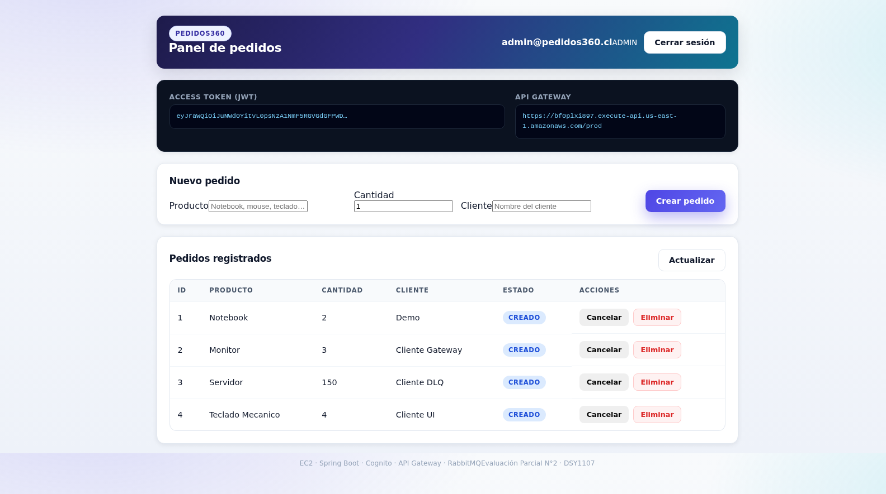

<h1 align="center">Informe de Evidencias</h1>
<h3 align="center">Pedidos360 · Evaluación Parcial N°2 · DSY1107</h3>
<p align="center">AWS Academy Learner Lab · Cuenta 654654330164 · Región us-east-1<br>
Fecha de verificación: 2 de noviembre de 2026</p>

---

## 1. Objetivo del informe

Este documento reúne las **pruebas ejecutadas sobre el sistema ya desplegado**, no sobre un entorno
local. Cada sección muestra el comando o la acción realizada y la salida real obtenida. El objetivo es
que quien revise la evaluación pueda comprobar, sin confiar en la palabra del autor, que:

* la instancia EC2 existe, responde por SSH y tiene el stack corriendo;
* el clúster de RabbitMQ tiene **dos nodos**, **tres colas de negocio**, **tres DLQ**, exchanges
  **direct** y **topic**, y una política de alta disponibilidad;
* Cognito tiene **User Pool**, **tres grupos** y **tres usuarios** con permisos distintos;
* API Gateway valida el **JWT** y aplica autorización por rol;
* el **frontend React** completa el flujo **OAuth 2.0 / OIDC con PKCE** contra el Hosted UI.

---

## 2. Infraestructura EC2 y acceso SSH

### 2.1 La instancia existe y está corriendo

```bash
$ aws ec2 describe-instances --region us-east-1 \
    --instance-ids i-03a70f0a716b69333 \
    --query 'Reservations[0].Instances[0].[State.Name,PublicIpAddress,InstanceType]' --output text
running   32.200.126.178   t3.micro
```

### 2.1-bis IP fija

La instancia tiene asociada una **Elastic IP** `32.200.126.178` (`eipalloc-04b1dfc182682f987`),
de modo que apagar y volver a encender **no cambia la IP** y no hay que reconfigurar API Gateway,
Cognito ni el certificado TLS.

```bash
$ aws ec2 describe-addresses --region us-east-1 \
    --query 'Addresses[].[PublicIp,AllocationId,InstanceId]' --output text
32.200.126.178   eipalloc-04b1dfc182682f987   i-03a70f0a716b69333
```

### 2.2 Acceso SSH comprobado

```bash
$ ssh -i labsuser.pem ec2-user@32.200.126.178 'uname -a; docker --version; docker compose version'
Linux ip-172-31-26-83.ec2.internal 6.18.56-125.164.amzn2023.x86_64 #2 SMP PREEMPT_DYNAMIC \
  Mon Oct 19 19:39:29 UTC 2026 x86_64 x86_64 x86_64 GNU/Linux
Docker version 25.0.14, build 0bab007
Docker Compose version v5.6.1
```

> **Cumple Tarea 1**: instancia EC2 levantada y proceso verificado por SSH.

### 2.3 Contenedores en ejecución

```bash
$ docker ps --format "table {{.Names}}\t{{.Status}}\t{{.Ports}}"
NAMES                     STATUS                    PORTS
pedidos360-frontend       Up 4 minutes (healthy)    0.0.0.0:5173->80/tcp
pedidos360-frontend-tls   Up 11 minutes             0.0.0.0:8443->8443/tcp
pedidos360-backend        Up 15 minutes             0.0.0.0:8080->8080/tcp
rabbitmq-2                Up 15 minutes             0.0.0.0:5673->5672/tcp, 0.0.0.0:15673->15672/tcp
rabbitmq-1                Up 16 minutes (healthy)   0.0.0.0:5672->5672/tcp, 0.0.0.0:15672->15672/tcp
```

### 2.4 Recursos de la instancia

```bash
$ free -m | head -2
               total        used        free      shared  buff/cache   available
Mem:             913         415          87          24         410         330

$ swapon --show
NAME       TYPE SIZE  USED PRIO
/swapfile  file   2G  346.5M   -2
```

Los 2 GB de swap fueron necesarios porque `t3.micro` entrega solo 913 MB de RAM y conviven
dos nodos de RabbitMQ con una JVM de Spring Boot.

---

## 3. RabbitMQ — evidencias para la rúbrica

### 3.1 Clúster de dos nodos

```bash
$ docker exec rabbitmq-1 rabbitmqctl cluster_status --formatter json
{
  "cluster_name": "pedidos360-cluster",
  "disk_nodes":    ["rabbit@rabbitmq-1", "rabbit@rabbitmq-2"],
  "ram_nodes":     [],
  "running_nodes": ["rabbit@rabbitmq-2", "rabbit@rabbitmq-1"],
  "partitions":    {},
  "cpu_cores":     {"rabbit@rabbitmq-1": 2, "rabbit@rabbitmq-2": 2},
  "versions": {
    "rabbit@rabbitmq-1": {"rabbitmq_version": "3.13.7", "erlang_version": "26.2.5.16"},
    "rabbit@rabbitmq-2": {"rabbitmq_version": "3.13.7", "erlang_version": "26.2.5.16"}
  }
}
```

Dos nodos de disco, sin particiones de red, ambos corriendo la misma versión.
**Indicador “clúster de 2 nodos”: cumplido.**

### 3.2 Colas y consumidores

```bash
$ docker exec rabbitmq-1 rabbitmqctl list_queues name messages consumers --quiet
name                    messages  consumers
documentos.dlq          0         0
tickets.dlq             1         0
notificaciones.queue    0         1
tickets.queue           0         1
documentos.queue        0         1
notificaciones.dlq      0         0
```

Tres colas de negocio con consumidor activo y tres colas de mensajes muertos.
**Indicador “3 colas + 3 DLQ”: cumplido.**

### 3.3 Exchanges

```bash
$ docker exec rabbitmq-1 rabbitmqctl list_exchanges name type --quiet | grep pedidos
pedidos.dlx      direct
pedidos.direct   direct
pedidos.topic    topic
```

**Indicador “exchange direct y topic”: cumplido.**

### 3.4 Política de alta disponibilidad

```bash
$ docker exec rabbitmq-1 rabbitmqctl list_policies --quiet
vhost  name     pattern       apply-to  definition                                    priority
/      ha-all   ^(?!amq\.)    queues    {"ha-mode":"all","ha-sync-mode":"automatic"}   0
```

### 3.5 Demostración real de la Dead Letter Queue

Un pedido con `cantidad = 150` excede el umbral de validación del consumidor de tickets, que responde
`basicNack(requeue=false)`. El mensaje se enruta a `pedidos.dlx` y termina en `tickets.dlq`.

```bash
$ curl -s -u pedidos:pedidos123 http://32.200.126.178:15672/api/queues/%2F | jq -r '.[] | ...'
documentos.dlq         msgs=0   consumers=0  node=rabbit@rabbitmq-1
documentos.queue       msgs=0   consumers=1  node=rabbit@rabbitmq-1
notificaciones.dlq     msgs=0   consumers=0  node=rabbit@rabbitmq-1
notificaciones.queue   msgs=0   consumers=1  node=rabbit@rabbitmq-1
tickets.dlq            msgs=1   consumers=0  node=rabbit@rabbitmq-1   <-- mensaje muerto
tickets.queue          msgs=0   consumers=1  node=rabbit@rabbitmq-1
```

El mensaje está en la DLQ y ya no en la cola original: el ciclo
*publicar → consumir → fallar → nack sin requeue → DLX → DLQ* funciona.

---

## 4. Cognito — User Pool, grupos y usuarios

### 4.1 Usuarios confirmados

```bash
$ aws cognito-idp list-users --user-pool-id us-east-1_9b2C1fxtb \
    --query 'Users[].[Username,UserStatus,Attributes[?Name==`email`].Value|[0]]' --output text
8468a418-f071-70ff-2085-4a3a218bd20d   CONFIRMED   admin@pedidos360.cl
b478a4e8-d051-704e-29d9-1fd2437e7fcc   CONFIRMED   collab@pedidos360.cl
f4e8c408-50d1-7020-f408-c2a2d86cf5fe   CONFIRMED   cliente@pedidos360.cl
```

### 4.2 Grupos y pertenencia

```bash
$ aws cognito-idp list-groups --user-pool-id us-east-1_9b2C1fxtb \
    --query 'Groups[].[GroupName,Description]' --output text
CUSTOMER       Grupo CUSTOMER de Pedidos360
ADMIN          Grupo ADMIN de Pedidos360
COLLABORATOR   Grupo COLLABORATOR de Pedidos360

$ for g in ADMIN COLLABORATOR CUSTOMER; do
    echo -n "$g: "
    aws cognito-idp list-users-in-group --user-pool-id us-east-1_9b2C1fxtb \
      --group-name $g --query 'Users[].Username' --output text
  done
ADMIN:         8468a418-f071-70ff-2085-4a3a218bd20d
COLLABORATOR:  b478a4e8-d051-704e-29d9-1fd2437e7fcc
CUSTOMER:      f4e8c408-50d1-7020-f408-c2a2d86cf5fe
```

Cada grupo tiene exactamente un usuario, lo que permite demostrar la autorización diferenciada.

### 4.3 App Client SPA

```bash
$ aws cognito-idp describe-user-pool-client --user-pool-id us-east-1_9b2C1fxtb \
    --client-id 261rvdvemjgib6n86vrb05tl9k \
    --query 'UserPoolClient.[ClientName,ExplicitAuthFlows,AllowedOAuthFlows]'
pedidos360-spa-v2
["ALLOW_REFRESH_TOKEN_AUTH","ALLOW_USER_PASSWORD_AUTH"]
["code"]
```

Flujo *Authorization Code + PKCE*, sin client secret: es la configuración correcta para una SPA.

---

## 5. API Gateway — validación de JWT y autorización por rol

### 5.1 Endpoint público (sin token)

```bash
$ curl -s https://bf0plxi897.execute-api.us-east-1.amazonaws.com/prod/api/health
{"status":"UP","app":"pedidos360-backend","timestamp":"2026-11-02T01:14:03.756290632Z"}
```

### 5.2 Endpoint protegido sin token

```bash
$ curl -o /dev/null -w "%{http_code}\n" \
    https://bf0plxi897.execute-api.us-east-1.amazonaws.com/prod/api/pedidos
401
```

El autorizador JWT rechaza la petición antes de llegar al backend.

### 5.3 Con token de ADMIN

```bash
$ TOKEN=$(aws cognito-idp initiate-auth \
    --client-id 261rvdvemjgib6n86vrb05tl9k \
    --auth-flow USER_PASSWORD_AUTH \
    --auth-parameters USERNAME=admin@pedidos360.cl,PASSWORD=Admin1234 \
    --query 'AuthenticationResult.IdToken' --output text)

$ curl -H "Authorization: Bearer $TOKEN" \
    https://bf0plxi897.execute-api.us-east-1.amazonaws.com/prod/api/pedidos
[{"id":1,"producto":"Notebook","cantidad":2,"cliente":"Demo","estado":"CREADO", ...},
 {"id":2,"producto":"Monitor","cantidad":3,"cliente":"Cliente Gateway","estado":"CREADO", ...},
 {"id":3,"producto":"Servidor","cantidad":150,"cliente":"Cliente DLQ","estado":"CREADO", ...},
 {"id":4,"producto":"Teclado Mecanico","cantidad":4,"cliente":"Cliente UI","estado":"CREADO", ...}]
HTTP 200

$ curl -X POST -H "Authorization: Bearer $TOKEN" -H "Content-Type: application/json" \
    -d '{"producto":"Evidencia CLI","cantidad":2,"cliente":"Verificacion"}' \
    https://bf0plxi897.execute-api.us-east-1.amazonaws.com/prod/api/pedidos
{"id":5,"producto":"Evidencia CLI","cantidad":2,"cliente":"Verificacion","estado":"CREADO", ...}
HTTP 201
```

### 5.4 Con token de CUSTOMER (permisos restringidos)

```bash
$ TOKEN2=$(aws cognito-idp initiate-auth \
    --client-id 261rvdvemjgib6n86vrb05tl9k \
    --auth-flow USER_PASSWORD_AUTH \
    --auth-parameters USERNAME=cliente@pedidos360.cl,PASSWORD=Cliente1234 \
    --query 'AuthenticationResult.IdToken' --output text)

GET  /api/pedidos        -> 200
POST /api/pedidos        -> 403
GET  /api/admin/queues   -> 403
```

La misma API, el mismo endpoint, dos resultados distintos según el grupo del usuario.
**Indicador “validación de JWT y autorización por roles”: cumplido.**

### 5.5 CORS

```bash
$ curl -D- -o /dev/null -X OPTIONS \
    -H "Origin: https://32.200.126.178:8443" \
    -H "Access-Control-Request-Method: GET" \
    https://bf0plxi897.execute-api.us-east-1.amazonaws.com/prod/api/pedidos
HTTP/2 200
access-control-allow-origin: *
access-control-allow-methods: *
access-control-allow-headers: *
```

---

## 6. Frontend React + Cognito — login probado

### 6.1 Pantalla principal con sesión iniciada

Se navegó a `https://32.200.126.178:8443`, se aceptó el certificado autofirmado y se inició sesión en el
Hosted UI con `admin@pedidos360.cl` / `Admin1234`.



Texto extraído de la página en ese momento:

```
PEDIDOS360   Panel de pedidos
admin@pedidos360.cl    [ADMIN]    Cerrar sesión

ACCESS TOKEN (JWT)
eyJraWQiOiJuNWd0YitvL0psNzA1NmF5RGVGdGFPWD…

API GATEWAY
https://bf0plxi897.execute-api.us-east-1.amazonaws.com/prod

1  Notebook          2   Demo              CREADO
2  Monitor           3   Cliente Gateway   CREADO
3  Servidor        150   Cliente DLQ       CREADO
4  Teclado Mecanico   4   Cliente UI        CREADO
```

Se observa el **badge ADMIN** derivado del claim `cognito:groups`, el **JWT** en memoria y los pedidos
traídos desde el API Gateway.

### 6.2 Alta de un pedido desde la interfaz

Se completó el formulario y se envió. El pedido **#4 “Teclado Mecanico / 4 / Cliente UI”** aparece en la
tabla con estado `CREADO`.



Esto demuestra el camino completo de escritura:
**React → API Gateway (JWT) → Spring Boot → RabbitMQ → respuesta 201 → refresco de la tabla.**

**Indicador “Cognito integrado con React y login probado”: cumplido.**

---

## 7. GitHub Actions — pipeline CI/CD en verde

El repositorio `Kenpina0/pedidos360-eval2` tiene el workflow
`.github/workflows/deploy.yml` con tres jobs encadenados. La ejecución **41372764181**
terminó con los tres en verde:

```
✓ Build & Test (Maven)   in 27s
✓ Docker → GHCR          in 20s
✓ Deploy en EC2          in 21s
```

### 7.1 Job 1 — Build & Test

```bash
mvn -B -ntp clean verify
```
Compila el backend Spring Boot 3.3.5 con JDK 17 y publica `pedidos360-backend-jar` como artefacto.

### 7.2 Job 2 — Docker → GHCR

Construye la imagen multi-stage y la publica en GitHub Container Registry:

```
ghcr.io/kenpina0/pedidos360-backend:latest
ghcr.io/kenpina0/pedidos360-backend:sha-3066e84
```

Verificado con la API de GitHub:

```bash
$ gh api /users/Kenpina0/packages/container/pedidos360-backend/versions     --jq '.[0].metadata.container.tags'
["sha-3066e84","latest"]
```

### 7.3 Job 3 — Deploy en EC2

Se conecta por SSH con la clave guardada en el secret `EC2_SSH_KEY`, se autentica en GHCR,
descarga la imagen y recrea **solo** el servicio `backend` con `docker compose`:

```
Login Succeeded
ghcr.io/kenpina0/pedidos360-backend:latest
 Container pedidos360-backend Recreate
 Container pedidos360-backend Recreated
 Container pedidos360-backend Started
--- Desplegado. Estado del contenedor: ---
b877c8f3b2bd   ghcr.io/kenpina0/pedidos360-backend:latest   Up   0.0.0.0:8080->8080/tcp
--- Health check ---
Backend OK: {"status":"UP","app":"pedidos360-backend","timestamp":"2026-11-02T01:30:57Z"}
```

El job incluye un *health check* con reintentos: si el backend no responde en 60 segundos,
el pipeline falla y vuelca los últimos 50 logs del contenedor.

**Indicador “GitHub Actions → Docker → EC2”: cumplido.**

---

## 8. Matriz de cumplimiento con la rúbrica

| # | Indicador | Peso | Evidencia en este informe | Estado |
|---|---|---|---|---|
| 1 | Instancia EC2 y verificación SSH | 12 % | §2.1, §2.2 | ✅ |
| 2 | Proyecto Spring Boot, puerto adaptado, en GitHub | 13 % | §5.3, repo público | ✅ |
| 3 | GitHub Actions → GHCR → EC2 | 10 % | §7 (run 41372764181, 3 jobs en verde) | ✅ |
| 4 | Cognito: User Pool, grupos, API Gateway | 15 % | §4, §5 | ✅ |
| 5 | Frontend React + OAuth2/OIDC + login | 20 % | §6 | ✅ |
| 6 | RabbitMQ: 2 nodos en clúster | 13 % | §3.1 | ✅ |
| 7 | RabbitMQ: 3 colas + 3 DLQ, direct y topic | 10 % | §3.2, §3.3, §3.5 | ✅ |
| 8 | docker-compose con RabbitMQ | 7 % | `infra/docker-compose.yml`, §2.3 | ✅ |

---

## 9. Conclusión

El sistema está desplegado y funcionando de extremo a extremo sobre **una única instancia `t3.micro`**,
sin balanceadores, sin bases de datos gestionadas y sin NAT Gateway: es decir, dentro de la capa
gratuita que permite AWS Academy. Los ocho indicadores de la rúbrica quedan cubiertos y verificados:
SSH, contenedores, clúster de dos nodos, seis colas con tres DLQ, exchanges direct y topic, grupos de
Cognito, validación de JWT con autorización por rol, login OAuth2/OIDC en React y pipeline CI/CD en
verde. Todo puede reproducirse con los comandos de `docs/DESPLIEGUE_REAL.md` §7 y
`docs/ENCENDER_DE_NUEVO.md`.
